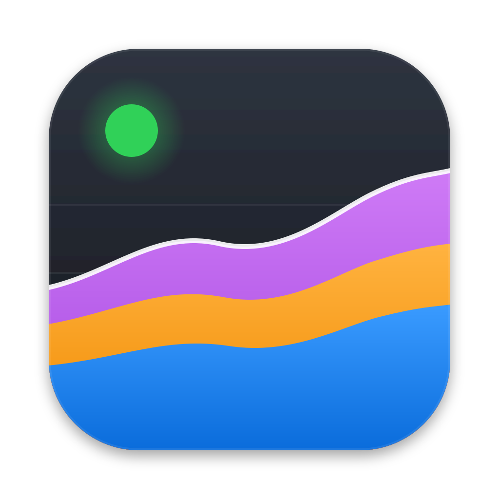
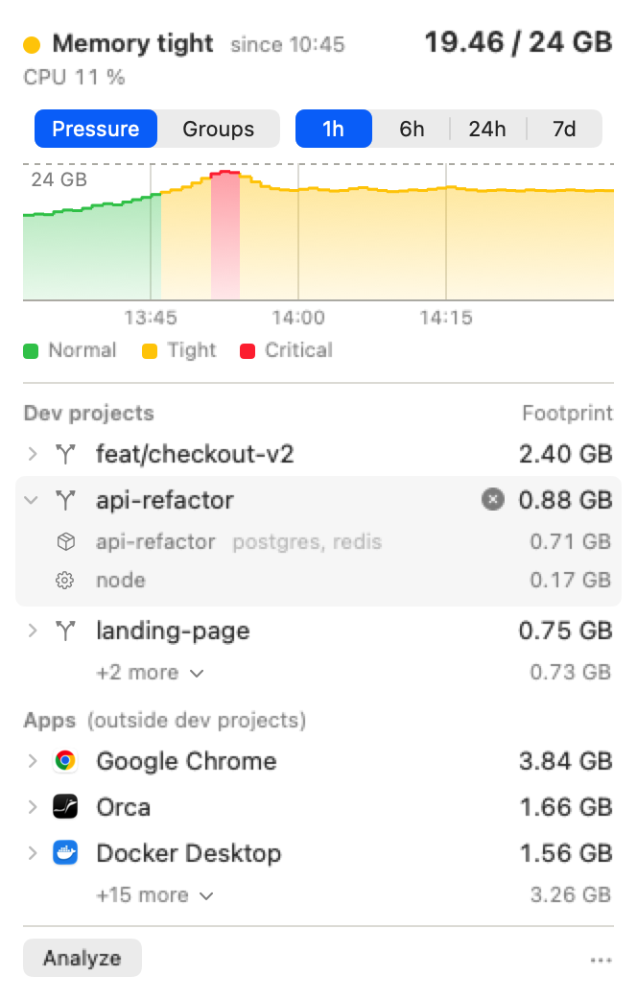
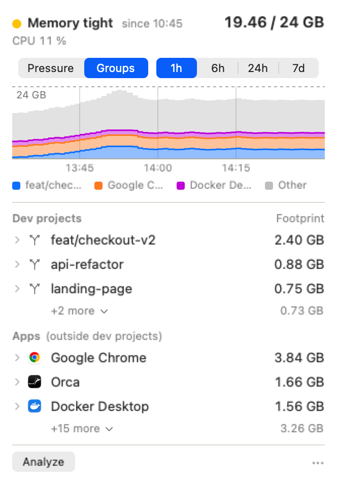
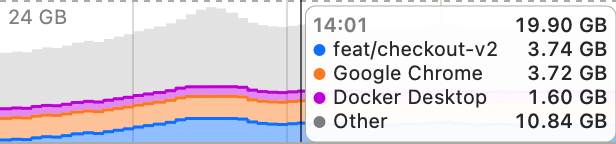
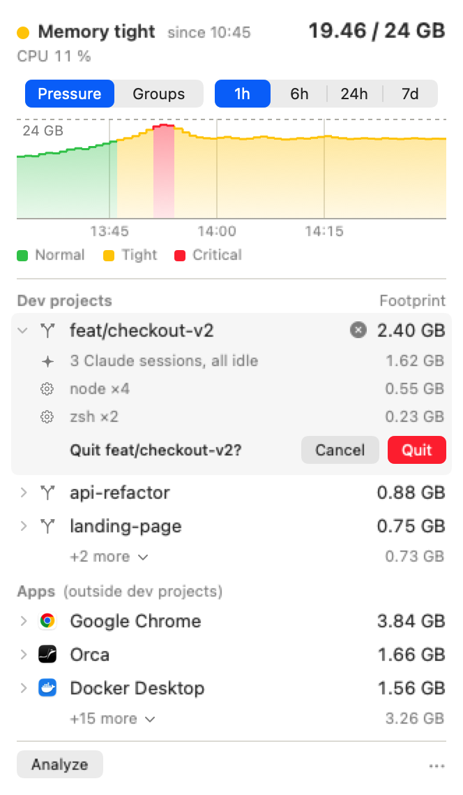
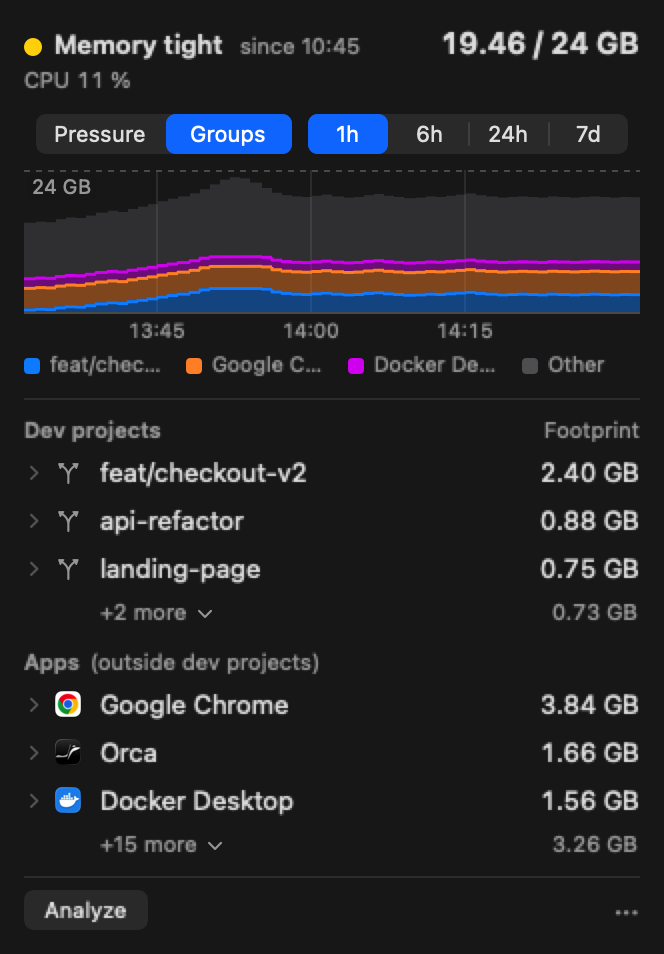

<p align="center">
  
</p>

<h1 align="center">devload</h1>

<p align="center">
  <b>Which dev project is eating your RAM?</b><br>
  A menu bar memory monitor for macOS 26 that groups memory by worktree, coding-agent session and Docker stack.
</p>

<p align="center">
  <a href="https://github.com/gaspardmoindrot/devload/releases/latest"></a>
  <a href="https://github.com/gaspardmoindrot/devload/actions/workflows/ci.yml"></a>
  
  
  <a href="LICENSE"></a>
</p>

<p align="center">
  <picture>
    <source media="(prefers-color-scheme: dark)" srcset="docs/images/popover-dark.png">
    
  </picture>
</p>

Activity Monitor lists processes. When you run several worktrees, Claude Code or Codex sessions and a few `docker compose` stacks at once, that list doesn't tell you which *project* is using the memory. devload adds up every process behind each one and shows the totals in your menu bar.

- **Menu bar figure:** memory used in GB, with a green / orange / red dot for memory pressure.
- **Dev projects:** one row per git worktree, with its dev servers, watchers, agent sessions (Claude Code, Codex) and Docker containers summed together.
- **Apps (outside dev projects):** Chrome, Slack, Docker Desktop and the rest, each app's helpers grouped under it. Nothing is counted twice.
- **Graph:** memory used over 1 h, 6 h, 24 h or 7 days. Hover to read the time and the exact values.
- **Quit:** quit an app, or stop a dev project's processes and Docker containers, from the popover (with a confirmation).
- **Analyze:** copies a ready-made prompt for Claude Code, Codex or any agent. It points to the local database and asks the agent what looks wrong and why.
- **Light:** one native process, no daemon, no network. See [Performance](#performance).

> [!NOTE]
> devload is a personal project, built and used daily on an Apple Silicon Mac running macOS 26. It is not signed with an Apple Developer ID. Read [Install](#install) before you download it.

## Contents

- [Install](#install)
- [What you see](#what-you-see)
- [How it works](#how-it-works)
- [Privacy](#privacy)
- [Performance](#performance)
- [FAQ and limits](#faq-and-limits)
- [Build from source](#build-from-source)
- [Uninstall](#uninstall)
- [Contributing](#contributing)
- [License](#license)

## Install

**Requirements:** macOS 26 (Tahoe) or later, Apple Silicon.

### Download a release

1. Download `Devload-<version>.zip` and `Devload-<version>.zip.sha256` from the [latest release](https://github.com/gaspardmoindrot/devload/releases/latest).
2. Optional: check the zip is the one the release workflow built. In the folder where you downloaded both files:

   ```sh
   shasum -a 256 -c Devload-<version>.zip.sha256
   ```

   It should print `Devload-<version>.zip: OK`.
3. Unzip it and move `Devload.app` to `/Applications`.
4. Let macOS run it (see the next section for why), then open it:

   ```sh
   xattr -dr com.apple.quarantine /Applications/Devload.app
   open /Applications/Devload.app
   ```

### Why macOS warns you, and the two ways past it

devload is ad-hoc signed, **not signed with an Apple Developer ID and not notarized**. That needs the paid Apple Developer Program ($99 a year), and devload is a free side project for developers. So when you open a downloaded copy, Gatekeeper says it can't check the app for malicious software and only offers *Move to Trash* or *Done*. Nothing is wrong with the file: macOS just doesn't know who signed it.

Pick one:

- **Terminal (fastest):** the `xattr` command in step 4 removes the "downloaded from the internet" flag, so Gatekeeper doesn't check the app. Each new version you download needs it again.
- **System Settings:** open the app once and click *Done* on the warning. Then go to **System Settings → Privacy & Security**, scroll down to **Security**, and click **Open Anyway** next to the line about Devload. Confirm with your password or Touch ID. macOS remembers the choice for this copy.

> [!IMPORTANT]
> Only do this for software you trust. You can check what you run: the zip is built from the tagged source by the public [release workflow](.github/workflows/release.yml), and its SHA-256 is published next to it. If you'd rather not trust a binary at all, [build it yourself](#build-from-source). It takes about two minutes, and a locally built app is never quarantined.

To start devload at login, turn on **Launch at login** in the **···** menu at the bottom right of the popover.

### Build from source

See [Build from source](#build-from-source). A locally built app isn't quarantined, so there's no Gatekeeper step.

## What you see

| Pressure mode | Groups mode |
|---|---|
|  |  |

- **Header:** memory used out of total, the pressure level and how long it has lasted, and machine CPU.
- **Graph:** *Pressure* draws memory used, coloured by pressure. *Groups* stacks your three biggest groups plus "Other". Your last choice of period and mode is kept.
- **Dev projects:** one row per worktree, named after its folder. Expand a row to see its parts (dev server, agent session, Docker stack…) and their own figures.
- **Apps (outside dev projects):** everything else that uses memory, grouped by app. A process that belongs to a dev project is never counted here too.
- **System:** processes owned by root or other users. macOS doesn't let a normal app read their memory, so devload shows how many there are, not how much memory they use.

<details>
<summary>More screenshots</summary>

| Hover on the graph | Quit a project | Dark mode |
|---|---|---|
|  |  |  |

</details>

### The Analyze button

**Analyze** copies a prompt to your clipboard. devload doesn't run any agent. Paste the prompt into Claude Code, Codex or any agent that can run `sqlite3`. It's short on purpose: it gives the period shown on the graph and the path to devload's database, asks the agent to open it read-only, and to say what looks problematic and why. The agent reads the data itself.

```text
Look at what happened on my Mac over the last 6 hours.

devload records its memory and CPU in a SQLite database:
  ~/'Library/Application Support/devload/devload.sqlite'

Open it read-only (sqlite3 -readonly) and start with .schema, every column is commented.

Tell me what looks problematic and why. Don't change anything without asking me first.
```

Secrets are removed from process arguments before they go into the database or the prompt: `--token` style flags, URLs with credentials and well-known token formats.

## How it works

devload is one process: a Rust core (collection, grouping, storage) linked as a static library into a small Swift/AppKit app (menu bar item, popover, graph).

Every 5 seconds the core:

1. reads machine memory, pressure and CPU through Mach and `sysctl`,
2. lists processes and reads each one's memory footprint and CPU time through `proc_pid_rusage` (no `ps`, `top`, `lsof` or other subprocess),
3. assigns each new process to a group:
   - a **dev project** if its working directory is inside a git worktree, or if it descends from a Claude Code or Codex session started there,
   - a **Docker stack** from its `com.docker.compose.project` label, read through the Docker Engine socket,
   - otherwise the **app** responsible for it (Chrome Helper → Google Chrome),
4. writes one row per minute to a local SQLite database.

Memory is the **footprint**, the figure Activity Monitor shows in its Memory column, not RSS. "Memory used" in the menu bar is computed like Activity Monitor's *Memory Used*: app memory, wired and compressed.

See [docs/ARCHITECTURE.md](docs/ARCHITECTURE.md) for the details.

## Privacy

- **Everything stays on your Mac.** devload makes no network connection. There's no telemetry, no analytics, no update check.
- **What it reads:** process list, memory and CPU figures, each process's executable path, working directory and arguments, and three environment variables that mark agent sessions (`CLAUDE_CODE_SESSION_ID`, `CODEX_SESSION_ID`, `CODEX_THREAD_ID`). It also reads container labels and stats from the local Docker socket, if one exists. It doesn't read any other environment variable or any file content.
- **What it stores:** `~/Library/Application Support/devload/devload.sqlite`. It keeps one row per minute for 7 days, then hourly rows for 90 days. Process arguments are scrubbed of secrets before they are stored.
- **Permissions:** none. devload sends no notifications and needs no Accessibility, Full Disk Access or Screen Recording permission.

## Performance

devload is meant to be cheaper than the problem it watches. Measured on an M5 Pro (24 GB) running macOS 26.5 with about 730 processes, popover closed:

| What | Result |
|---|---|
| CPU | 0.2 % of one core on average |
| Memory (footprint) | about 29 MB |
| One 5 s tick | 6.6 ms on average (p95 8.4 ms) |
| Disk writes | about 2 MB per hour |
| Database size | about 48 MB after 90 days, then flat |
| App size | 4.1 MB |

How it was measured, and how to run it again: [docs/benchmarks.md](docs/benchmarks.md).

## FAQ and limits

<details>
<summary><b>Why isn't the app signed?</b></summary>

Signing with a Developer ID and notarizing needs the Apple Developer Program, which costs $99 a year. devload is a free side project for developers, so it's ad-hoc signed and the source is public. Use the `xattr` command from [Install](#install), or build it yourself.
</details>

<details>
<summary><b>The icon doesn't show up in the menu bar</b></summary>

- **Not enough room:** on a MacBook with a notch, icons that don't fit are hidden behind it. Quit another menu bar app or use a menu bar manager.
- **Not allowed:** open **System Settings → Menu Bar** and check that devload is allowed.
- **Started from a terminal:** macOS 26 can attribute a menu bar item to the app that launched it (your terminal) and hide it if that app isn't allowed in the menu bar. Start devload from Finder, Spotlight or with `open /Applications/Devload.app`, not by running the binary inside the bundle. `make run` already goes through `open`.

If devload is already running, a second launch tells you so and quits.
</details>

<details>
<summary><b>Some memory isn't attributed to anything</b></summary>

The menu bar figure counts the whole Mac, including the kernel, file cache that can't be freed, and processes owned by root or other users. A normal app can't read the footprint of processes it doesn't own, so the lists don't always add up to the total.
</details>

<details>
<summary><b>Which Docker setups work?</b></summary>

Docker Desktop, OrbStack and Colima, through the active Docker context (`DOCKER_HOST`, then `docker context`, then the default sockets). Containers are grouped by `docker compose` project. If the Compose file is inside a worktree, the containers count toward that dev project. Their memory is read from the Docker API, and the VM that runs them isn't counted a second time.
</details>

<details>
<summary><b>Intel Macs? Older macOS?</b></summary>

No. devload targets macOS 26 and Apple Silicon only, and is only tested there.
</details>

<details>
<summary><b>Where are the logs?</b></summary>

devload writes a few lines to standard error, which macOS discards when you launch from Finder. To keep them, quit devload and start it with:

```sh
open -n --stderr ~/devload.log --env DEVLOAD_TRACE=1 /Applications/Devload.app
```

`DEVLOAD_TRACE=1` adds timings.
</details>

## Build from source

You need macOS 26, Xcode 26 (or its Command Line Tools with Swift 6.2) and Rust 1.85 or later (`rustup`).

```sh
git clone https://github.com/gaspardmoindrot/devload.git
cd devload
make app                     # build/Devload.app, ad-hoc signed
cp -R build/Devload.app /Applications/
open /Applications/Devload.app
```

Other targets:

```sh
make test        # Rust tests, C ABI smoke test, Swift tests
make snapshots   # PNGs of the icon and popover from sample data, in build/snapshots
make run         # run from build/ with its data in build/dev-data, logs in build/run.log
```

`DEVLOAD_DATA_DIR=/some/folder` makes devload use another data folder, so a development build doesn't touch your real history.

## Uninstall

```sh
osascript -e 'quit app "Devload"'   # or ··· → Quit devload
rm -rf /Applications/Devload.app
rm -rf ~/Library/Application\ Support/devload   # your history
```

If you turned on **Launch at login**, turn it off in the popover's **···** menu before you delete the app, or remove devload from **System Settings → General → Login Items** afterwards.

## Contributing

Bug reports and pull requests are welcome. See [CONTRIBUTING.md](CONTRIBUTING.md). For security issues, see [SECURITY.md](SECURITY.md).

## License

[MIT](LICENSE)
